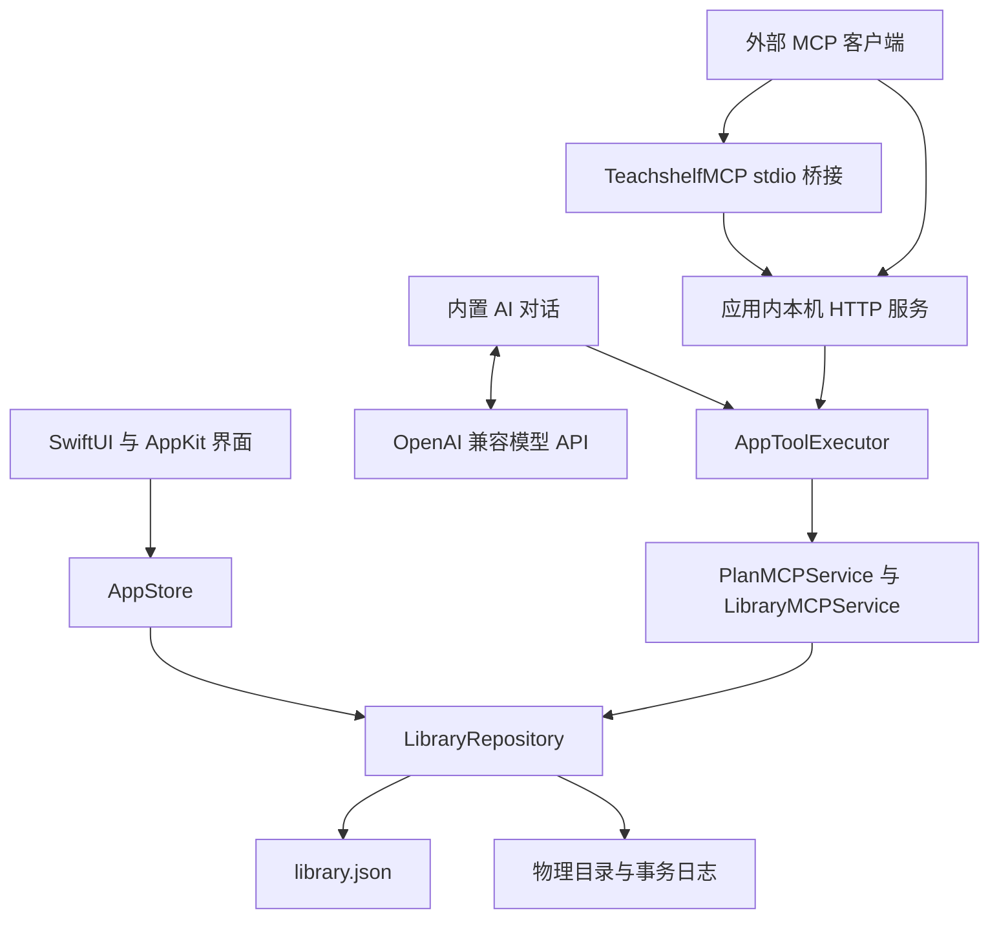

# 架构与代码导航

[项目首页](../README.md) · [开发指南](development.md) · [备份恢复](backup-restore.md)

本文按 1.16.1（77）的实现说明当前主线。功能使用见 [使用指南](usage.md)，历史版本验收不作为当前架构依据。

## 模块与执行链路

[Package.swift](../Package.swift) 定义 4 个实现 target、3 个测试 target，以及 Core 库、原生应用、MCP stdio 桥接共 3 个 product。构建使用 Swift 6 工具链，当前源码语言模式为 Swift 5，无第三方 Swift 包依赖。

- **TeachshelfCore**：模型、计划与课表规则、资料库、文件事务和工具业务服务。它不创建界面，但文件系统实现使用 Darwin 等 macOS 能力，不能视为已验证的跨平台库。
- **Teachshelf**：应用入口、`AppStore`、SwiftUI 页面、AppKit 控件、WebKit 导入与教学网站、钥匙串、文件事件和内置模型客户端。应用拥有正在打开的资料库实例。
- **TeachshelfMCPKit**：JSON-RPC、协议协商、HTTP 传输与访问令牌配置；不另开一个正式资料库写入者。
- **TeachshelfMCP**：独立 stdio 进程，将客户端请求转发给正在运行的应用。退出课屿后桥接无法继续编辑资料库。

内置 AI 经 `AppToolExecutor` 直接复用 Core 工具服务，不绕行外部 MCP HTTP 端口。模型的 Chat Completions API 与 MCP 工具传输是两种独立接口；API Key 与 MCP Bearer 令牌也分别保存。详见 [AI](AI.md) 与 [MCP](MCP.md)。

## 状态、锁与写入边界

`AppStore` 在主 actor 管理导航、界面状态、忙碌标志和仓库实例。`AppToolExecutor` 检查当前资料库、编辑窗口和版本要求，再在后台执行 Core 操作；完成后刷新界面。内置助手在写操作前另外要求用户确认，外部 MCP 的确认由调用客户端负责。

`LibraryRepository` 通过 `.teachshelf.lock` 的 `flock` 获得资料库独占写入权，使用递归状态锁串行化同一实例的操作。`state` 返回状态值副本；领域扩展共享一个仓库，不能各自创建可写状态。

普通元数据修改通过 `commit`：先对账，再复制状态、修改和校验，最后调用 `saveSnapshot`。涉及物理目录时，先写文件事务日志并移动文件，成功持久化索引后才发布新内存快照。索引保存先同步临时文件，更新 `library.json.bak`，最后原子替换 `library.json`。恢复备份复用同一原子索引安装边界，但有单独的整库事务。

直接编辑 `library.json` 会绕过关联校验、并发保护和文件事务。新增功能应复用领域方法；不要让界面、模型响应或传输层直接写索引。

## 启动与恢复顺序

1. 标准化资料库路径，检查锁路径并取得独占锁。
2. 优先重放 `.backup-restore.json`，将目录和索引恢复到同一版本。
3. 加载并校验索引，准备 `files/`。
4. 处理 `.physical-storage.jsonl`，随后处理旧 `.material-relocation.json`。
5. 加载 `.file-observations.json`，对当前格式资料库执行 Finder 对账。
6. 通过存储事务完成必要的旧格式迁移和目录整理，再交给应用使用。

| 文件 | 职责与完成依据 |
| --- | --- |
| `.backup-restore.json` | 整库恢复：新旧索引的文件身份与 SHA-256、目录身份、阶段及实际位置共同决定回滚或完成提交 |
| `.physical-storage.jsonl` | 日常物理移动和当前迁移：写前记录，结合索引摘要、提交及逆操作进度判断恢复方向 |
| `.material-relocation.json` | 兼容旧迁移事务：按当前索引引用和保留副本状态完成清理或回滚 |
| `.file-observations.json` | 本机文件身份缓存，用于 Finder 改名、移动及丢失判断；不是事务提交日志 |

整库恢复在暂存库完成格式迁移，发布自己的日志前先处理正式库已有文件事务。正式库若同时出现无法解释的恢复日志和其他文件事务日志，会拒绝打开并保留现场。不要改变顺序，让 Finder 扫描先看到目录替换的中间状态。完整协议见 [备份恢复事务](backup-restore.md)。

## 数据与设备配置

| 内容 | 保存位置 | 是否进入资料库备份 |
| --- | --- | --- |
| 课程、资料、物理分组、计划、课表、教学来源、外观偏好 | 资料库 `library.json` | 是 |
| 入库副本、默认作业、恢复 History | 资料库目录 | 是 |
| 外部引用与外部作业挂载 | 索引只保存路径，内容在外部 | 仅路径 |
| 文件观察身份 | `.file-observations.json` | 备份包不包含；整库复制后按实际路径重新建立 |
| 当前资料库位置、模型地址／名称／兼容选项 | 本机应用偏好 | 否 |
| AI API Key、可选 Moodle 登录恢复 | macOS 钥匙串 | 否 |
| MCP 启用状态、端口、令牌 | `~/Library/Application Support/TeachshelfMCP/config.json` | 否 |
| AI 对话、导航历史、计划撤销记录 | 当前会话内存 | 否 |

库内路径默认是相对路径；格式 9 也保存 Finder 移动后必要的位置覆盖及丢失状态。课程、分组和资料的 UUID 保持关联身份，路径或显示名称不承担唯一身份的职责。所有受控文件操作沿用路径边界、符号链接检查和不覆盖目标的移动规则。

## 代码导航

| 位置 | 职责 |
| --- | --- |
| [Package.swift](../Package.swift) | Core 库、原生应用、MCP 服务与桥接，以及三个测试 target，无第三方包依赖 |
| [Sources/TeachshelfCore](../Sources/TeachshelfCore) | 数据模型、计划投影、课表、排序与配色等业务规则 |
| [LibraryRepository.swift](../Sources/TeachshelfCore/LibraryRepository.swift) | 资料库独占锁、状态快照、事务、索引兼容及原子保存 |
| [Repository/](../Sources/TeachshelfCore/Repository) | 按职责拆分的资料库操作，见下表 |
| [Sources/Teachshelf](../Sources/Teachshelf) | SwiftUI 页面、AppKit 控件与系统集成；入口为 `TeachshelfApp.swift`，共享界面状态为 `AppStore.swift` |
| [Sources/TeachshelfCore/MCP](../Sources/TeachshelfCore/MCP) | 计划/课程/资料/文件夹工具定义、参数校验、版本检查与原子编辑 |
| [Sources/Teachshelf/AI](../Sources/Teachshelf/AI) | 内置对话、兼容模型客户端、钥匙串配置、确认与结果卡片 |
| [Sources/TeachshelfMCPKit](../Sources/TeachshelfMCPKit) | MCP JSON-RPC、受令牌保护的本机 HTTP 服务与私有配置 |
| [Sources/TeachshelfMCP](../Sources/TeachshelfMCP) | 随应用打包的 stdio 桥接入口 |
| [Resources/](../Resources) | 应用信息、图标、本科课表与教学网站解析脚本 |
| [Tests/TeachshelfCoreTests](../Tests/TeachshelfCoreTests) | 数据、文件管理、迁移及业务回归 |
| [Tests/TeachshelfLayoutTests](../Tests/TeachshelfLayoutTests) | 原生布局、交互、WebKit 解析及网站更新流程回归 |
| [Tests/TeachshelfMCPTests](../Tests/TeachshelfMCPTests) | 协议、鉴权、HTTP / stdio 实际调用、计划及课程资料修改、冲突和文件事务回归 |
| [scripts/](../scripts) | 构建、启动、测试及图标生成 |

`Repository/` 中的文件扩展同一个 `LibraryRepository`，共享事务边界，不创建独立的资料库状态：

| 文件 | 职责 |
| --- | --- |
| `LibraryRepository+Courses.swift` | 课程保存、归档、删除及关联清理 |
| `LibraryRepository+Materials.swift` | 资料导入、引用、类别、排序、分组、废纸篓与 ZIP 导出 |
| `LibraryRepository+Plans.swift` | 计划、重复例外、完成状态、归档与撤销 |
| `LibraryRepository+Timetable.swift` | 本科课表导入、固定时段、调课与停课 |
| `LibraryRepository+TeachingWebsite.swift` | 课程连接、来源映射、文件与作业合并、截止冲突 |
| `LibraryRepository+Homework.swift` | 作业目录、外部挂载与目录操作 |
| `LibraryRepository+Backups.swift` | 备份、恢复入口及资料库复制 |
| `LibraryRepository+BackupRestore.swift` | 持久化恢复事务、提交点校验及启动重放 |
| `LibraryRepository+Preferences.swift` | 外观、过渡、强调色、边框与工具栏偏好 |
| `LibraryRepository+PhysicalStorage.swift` | 物理目录、写前日志、文件移动及可续接的失败回滚 |
| `LibraryRepository+FileSystemSync.swift` | 文件标识跟踪、Finder 移动和改名对账、丢失状态 |
| `LibraryRepository+StorageMigration.swift` | 文件布局计算、旧迁移日志恢复与旧作业目录迁移 |
| `LibraryRepository+FileSystem.swift` | 路径边界、符号链接检查、安全复制与原子重命名 |

修改资料库逻辑时，元数据变更通过 `commit` 提交；需要同时操作文件和索引时，在 `withLock` 内完成。共享快照只在核心文件内替换，索引成功保存后才更新内存状态。跨文件辅助方法仅在 Core 模块内可见，领域内部辅助方法保持私有。

## 平台范围

当前应用只构建 macOS 14+。SwiftUI 窗口、AppKit、WebKit、钥匙串、Finder/Quick Look、文件事件以及 Darwin 文件锁和重命名行为都有平台依赖。支持 Windows 需要替换这些界面和系统服务，并验证路径、文件身份、锁、原子提交和恢复语义；仅修改部署平台声明不足以完成移植。

仓库中的 [example](../example/README.md) 是独立 Windows WPF 参考项目，未参与当前构建和测试，其资料库格式也不直接兼容当前主线。当前仓库没有已交付的 Electron 跨平台产品。
